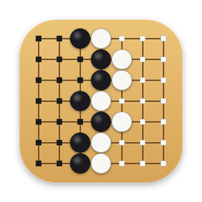
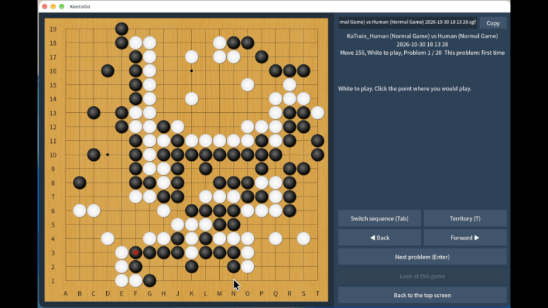
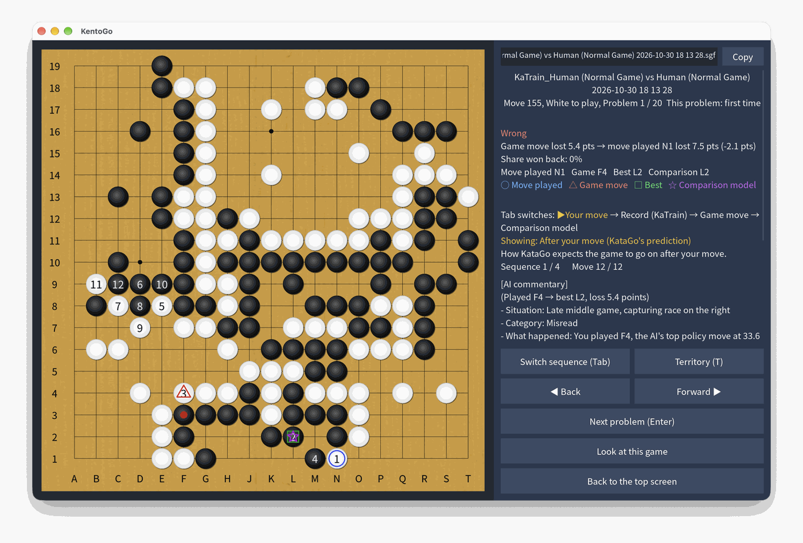
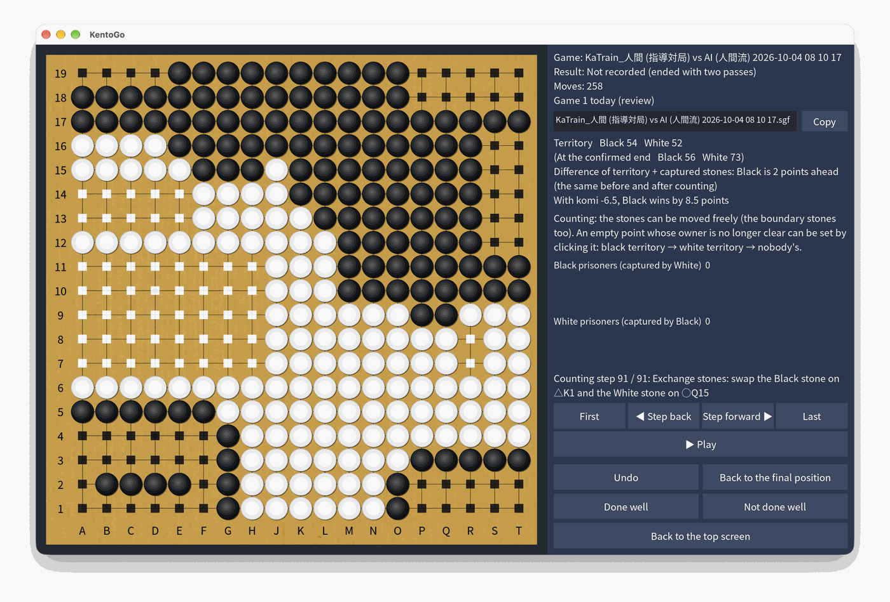
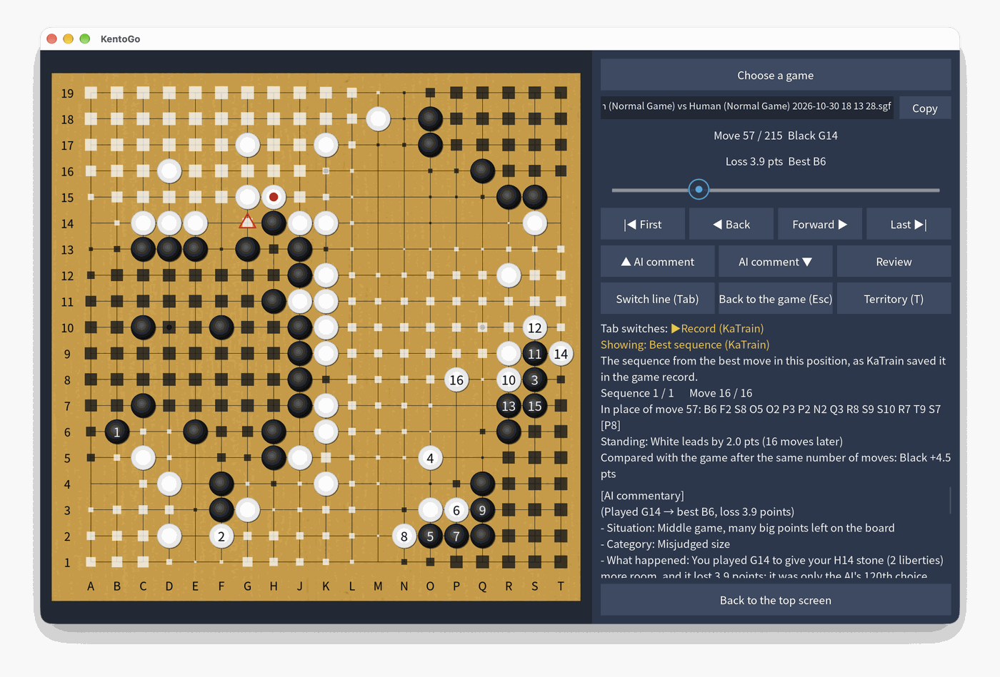

<p align="center">
  
</p>

<h1 align="center">KentoGo</h1>

<p align="center"><b>Learn from your own mistakes: Go problems made from your KaTrain games.</b></p>

<p align="center"><a href="japanese/README.md">日本語の README はこちら</a></p>

<p align="center">
  <a href="https://github.com/thamer1024/KentoGo/releases/latest"></a>
  <a href="https://github.com/thamer1024/KentoGo/releases"></a>
  
  <a href="LICENSE"></a>
</p>

KentoGo picks the moves where you lost the most points in your KaTrain games and asks them again
as problems, until you find a better move. It also has counting practice from the final positions
of your games, a game viewer with KataGo's best lines, and optional AI commentary on your games.
Free and open source, for Windows and macOS; it uses the KataGo you set up in KaTrain.

<p align="center"></p>

## What it does

- **Mistake problems.** The moves where you lost the most points become problems. Play your
  answer on the board, and KataGo judges it. The problems come back along a forgetting curve: a
  problem you miss is asked again the next day, and each correct answer makes the wait longer
  (3, 7, 14… days). A problem is finished after a set number of correct answers in a row (a small
  number, 2, at first; raise it in the settings for more reviews), and a wrong answer starts the
  count again.
- **Counting practice.** Count the final position of your own games: remove the dead stones, fill
  in the prisoners and tidy the territories, then check your count. KentoGo can also show how
  the territories are tidied (as a reference: even when the count is right, a step can be wrong or unnatural).
- **Game viewer.** Replay your games with the move KaTrain chose, a second model's line to
  compare with, and the territory and the score at the end of each line.
- **AI commentary (optional).** An AI such as ChatGPT, Claude, Gemini or DeepSeek can explain in
  words, not only in numbers, how your move differs from the move KaTrain chose: what each move
  aims at, and why one is better. Copy the prompt that KentoGo makes into the chat of any AI and
  paste the answer back, or let KentoGo ask the AI directly with an API key.

| Mistake problems | Counting practice | Game viewer |
| --- | --- | --- |
|  |  |  |

## Download

- **Windows:** `KentoGo-x.y.z-windows.exe` from the
  [latest release](https://github.com/thamer1024/KentoGo/releases/latest). It is one file: start it
  as it is. (`KentoGo-x.y.z-windows.zip` is the same program as a folder, which starts faster.)
- **macOS:** `KentoGo-x.y.z-macos.zip` from the same page. Unpack it and open KentoGo.app.
- **Linux:** run KentoGo from the source (see "Run from the source" below).

KataGo is not included: KentoGo uses the KataGo you set up in
[KaTrain](https://github.com/sanderland/katrain).

KentoGo.exe is not signed. Windows may stop it the first time it is started, with "Windows
protected your PC" (Microsoft Defender SmartScreen does this for programs that few people have
downloaded): click "More info", then "Run anyway". It is not asked again for the same file.

The app is not signed by Apple either. macOS stops an app downloaded from GitHub the first time:
open it with the right click > "Open", or run `xattr -dr com.apple.quarantine KentoGo.app`.

## Getting started

1. Set up KaTrain and its KataGo, and analyze some of your games in KaTrain.
2. Start KentoGo. At the first start it copies KaTrain's engine settings from
   `~/.katrain/config.json`. When those settings point inside the KaTrain program (paths that
   start with `katrain/`, as in KaTrain's default settings on Windows), KentoGo looks for
   KaTrain's program folder in the usual places. If it is not found, set "KaTrain's program
   folder" on the settings screen, or set the paths of KataGo, the model and KataGo's settings
   file there directly.
3. Choose the folder of your SGF files on the settings screen. The programs use
   `~/.kentogo/games` until another folder is chosen; KentoGo run from the source uses its
   `games` folder (SGF files are never added to git).

### Preparing your games in KaTrain

KentoGo makes its problems from what KaTrain saves in the SGF files, so a little care in KaTrain
gives better problems:

1. In KaTrain's "Teaching/Analysis Settings", check "Save in SGF" for the kinds of mistakes that
   suit your level, and check "Cache analysis in SGF".
2. After the game, run "Deeper full game analysis" with a "Number of visits per move" that your
   computer handles comfortably ("Limit analysis to mistakes only" is fine too), and then save the
   SGF file. KaTrain's best sequences are then saved more accurately.

### KataGo in KentoGo

How long KataGo takes depends much on the computer. The numbers of visits can be changed on the
settings screen, or chosen for your kind of computer under ☰ > "Recommended settings" (from an old
processor without a GPU to a high-end GPU).

KataGo is started with KentoGo, as in KaTrain, and runs until KentoGo is closed. A dialog shows
which model is loading and, from the second start on, about how long it will still take (the
loading times are kept in `~/.kentogo/katago_start_times.json`). You can close the dialog and go
on; a question to KataGo then waits until it is ready.

**About the comparison model.** "Also use the comparison model" on the settings screen starts a
second KataGo beside the main one. On some computers this makes KentoGo much slower, as the two
share the processor or the GPU, and it needs more memory (each KataGo holds its model and its
cache: several hundred MB to some GB). When it is turned on, the comparison model's KataGo is
started as soon as the main one is ready, and it keeps running until KentoGo is closed, so that
its sequences come without waiting for KataGo to start. Turn it on only if your computer has
room for two KataGo processes.

The settings, the history of answers and the results of the counting practice are kept in
`~/.kentogo` (on Windows, `C:\Users\<name>\.kentogo`). The programs have no console: their
messages are written to `~/.kentogo/kentogo.log`.

## Counting practice

The final position of a game is counted with the Japanese rules. When you have finished, press
"Finish the seichi" to check your count, then "Done well" or "Not done well" to go to the next game
(these two buttons appear after "Finish the seichi" or "Show the computer's counting"). Only the
buttons that can be used are shown. A game not done well is asked again on a later day, as the
mistake problems are. The order of the games, which games come first, the reviews and the most
games a day can be changed under ☰ > "Territory Counting Settings" (the results are kept
in `seichi_history.sqlite3`, next to the settings file).

1. Click the dead stones (connected stones become dead together; click again to undo).
2. Take the dead stones off: drag them out of the board, or press "Take off the dead stones".
3. Click the dame (empty points that are nobody's territory) to fill them with stones. Click a
   filled stone again to take it back.
4. Press "Confirm the end and start counting". The territory at this moment is the count that the
   counting has to keep.

The points counted as territory get a small square.

While counting, the stones can be moved freely (the stones of the boundary too). The count is the
territory at the confirmation, so it does not change when a stone of the boundary moves. An empty
point whose owner is no longer clear can be set by clicking it: black's territory, white's
territory, then nobody's. The number of points not yet set is shown on the right. "Show the
computer's counting" counts from the board at the confirmation (stones moved later are not used).

- Drag a stone to an empty point to move it.
- Drop it on a stone of the other color to swap the two stones.
- Drag the prisoners from their place below the board into the territory of the same color.
  Single stones and groups of ten (x10) fill the empty points from the end, where they are
  dropped. Drop them out of the board to put them back.
- The points of a seki and the dame shared in a seki are not counted (goscorer judges them).

"Show the computer's counting" plays the steps of the counting at once, one by one. Afterwards, the
play button and the ← → keys go through the steps. The computer never leaves a stone in the
other player's territory; when that cannot be helped (for example, when a dead stone was not
removed), it says so and does not count. A △ marks where a stone left, and a ○ where a stone was
put. When its own stones cannot make whole tens, the computer swaps a black and a white stone on
the board. It never changes the color of a stone with the bowls: when only that would work, it
gives up the neat shape and moves stones inside its own territory to come close to whole tens.

The computer's counting is made by a program, so take it as a reference: even when the count is
right, a step can be wrong, or not the natural way people tidy the territories.

## Languages

The screens are in English at the first start. Click a flag (on the start screen of the quiz, or in
the menu behind the ☰ button of the top screen, as in KaTrain) to change the language at once. The
language is kept in `~/.kentogo/settings.json` (`"general": {"language": "jp"}`). Languages:
English, German, French, Ukrainian, Spanish, Russian, Chinese (Simplified and Traditional),
Korean, Japanese and Turkish.

The AI commentary follows the language too. In Japanese, the Japanese prompt is used; in the
other languages, an English prompt asks the AI to answer in the language of the screens, and the
words that KentoGo writes into the game with the answer are in that language. Each prompt has its
own file to change (☰ > the AI commentary settings): `commentary_prompt_jp.txt` for Japanese and
`commentary_prompt_en.txt` for the English prompt, next to the settings file.

## Run from the source

1. Install [uv](https://docs.astral.sh/uv/) (it also installs Python 3.12 for KentoGo).
2. Get KentoGo: `git clone` this repository, or download it as a zip file and unpack it.
3. In the KentoGo folder, run:

   ```
   uv run kentogo
   ```

   The first start installs the libraries, which takes a while.

## Development (macOS or WSL)

```
uv sync                  # make the environment (Python 3.12 and the libraries)
uv run pytest            # run the tests (KataGo is not needed)
uv run ruff check        # check the code
uv run ruff format       # format the code
```

- One code base for all systems. The only places where the systems differ are
  `src/kentogo/katago/locate.py` (where KaTrain and KataGo are) and
  `src/kentogo/katago/process.py` (how KataGo is started).
- On WSL, keep the project in the Linux file system (for example `~/KentoGo`), not under
  `/mnt/c`, which is slow. Windows 11 shows the window through WSLg. To use KataGo there,
  use a KataGo for Linux (not `katago.exe`).
- GitHub Actions runs the checks and the tests on Windows, macOS and Linux for every push
  (`.github/workflows/test.yml`).

## Making the programs (KentoGo.exe and KentoGo.app)

Each program is made on its own system (PyInstaller cannot make a Windows program on macOS, or
the other way round).

- Windows: in the KentoGo folder, run in PowerShell

  ```
  powershell -ExecutionPolicy Bypass -File packaging\windows\build.ps1
  ```

  It makes KentoGo.exe in two forms, from the same files:
  - `dist\KentoGo.exe`: one file with everything in it. It unpacks itself into a temporary folder
    at each start, so it starts a little slower.
  - `dist\KentoGo` (start `KentoGo.exe` in it), also as `dist\KentoGo-windows.zip`: a folder,
    which starts faster.
- macOS: in the KentoGo folder, run

  ```
  bash packaging/macos/build.sh
  ```

  It makes `dist/KentoGo.app` (open it, or move it to the Applications folder) and
  `dist/KentoGo-macos.zip`. The app is made for the processor of that Mac (Apple silicon or Intel).
  An app made on your own Mac opens as it is.
- On GitHub, run the "windows-exe" or "macos-app" workflow (Actions > the workflow > Run
  workflow). The programs can be downloaded from the page of the run. They also run for tags
  such as `v0.1.0`.
- To publish the programs, run the "release" workflow (Actions > release > Run workflow). It makes
  both programs from the last commit of the chosen branch and puts them on a new release
  (Releases), as `KentoGo-0.1.0-windows.exe` (one file), `KentoGo-0.1.0-windows.zip` (the folder)
  and `KentoGo-0.1.0-macos.zip`. The version is the time of the commit, as written in it: the
  hour, the minute and the second (a commit made at 00:01:00 is 0.1.0, with the tag `v0.1.0`).
  The programs show the version at the bottom of the top screen, and KentoGo.exe also in its
  properties (Details); KentoGo run from the source shows none.

The icon (a board split into black's and white's territory by a stepping wall of stones) is in
`packaging/icons`, and the same icon of the window is `src/kentogo/images/app_icon.png`. They are made
with `python tools/make_icon.py packaging/icons --window-icon src/kentogo/images/app_icon.png`
(needs Pillow).

## Acknowledgments

KentoGo is built on two projects, and thanks their authors:

- [KataGo](https://github.com/lightvector/KataGo) by David J. Wu (lightvector): the Go engine that
  analyzes the games and judges the answers.
- [KaTrain](https://github.com/sanderland/katrain) by Sander Land (sanderland): the app in which the
  games are played and analyzed. KentoGo reads its analysis and follows its look.

KentoGo is an independent project. It is not part of KaTrain or KataGo, and is not endorsed by
their authors. It is released under the MIT License (see `LICENSE`); the parts that come from
other projects are listed in `THIRD_PARTY_NOTICES.md`.

## How KentoGo was made

The author designed KentoGo (its features and structure), and the code was written by Claude
Code (Anthropic's AI coding tool) following that design, through conversations with the author.
