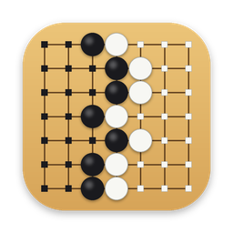
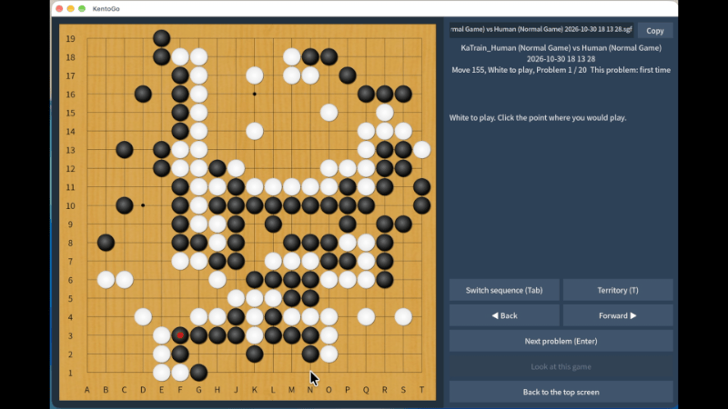
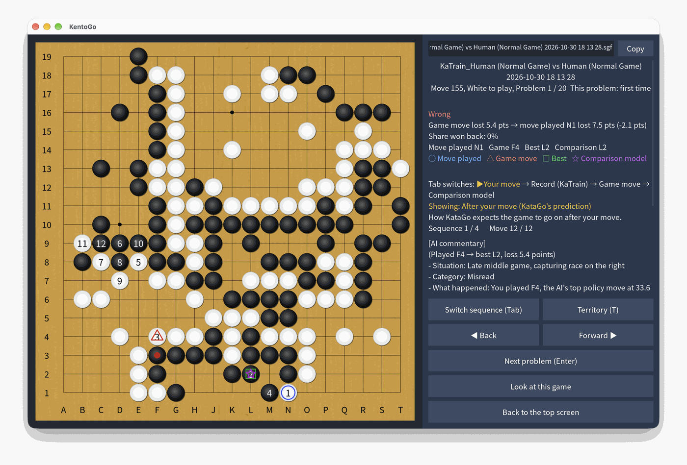
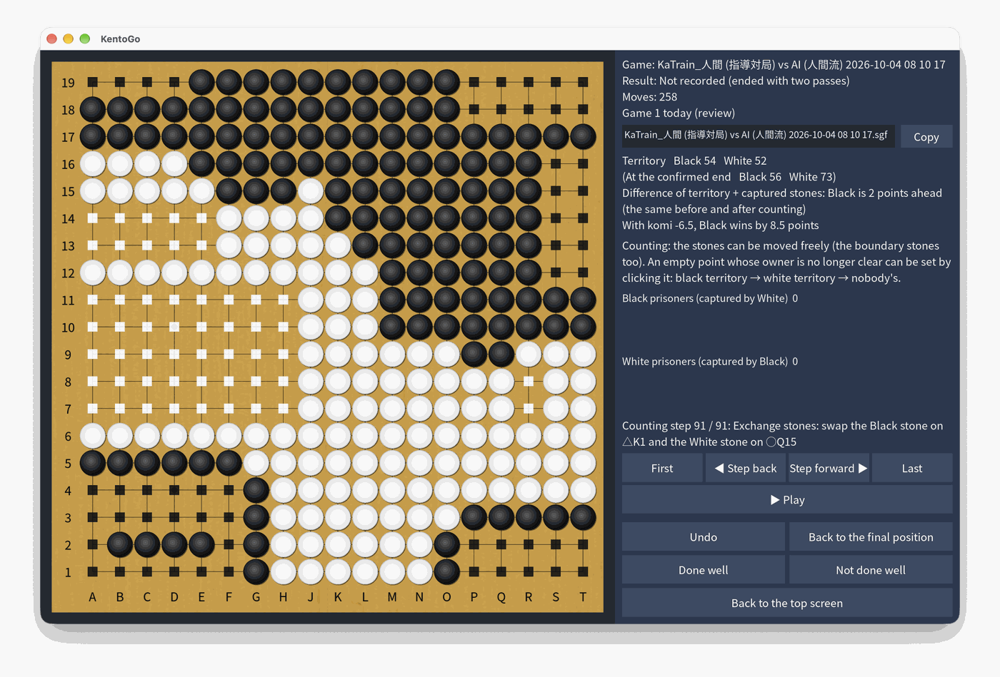
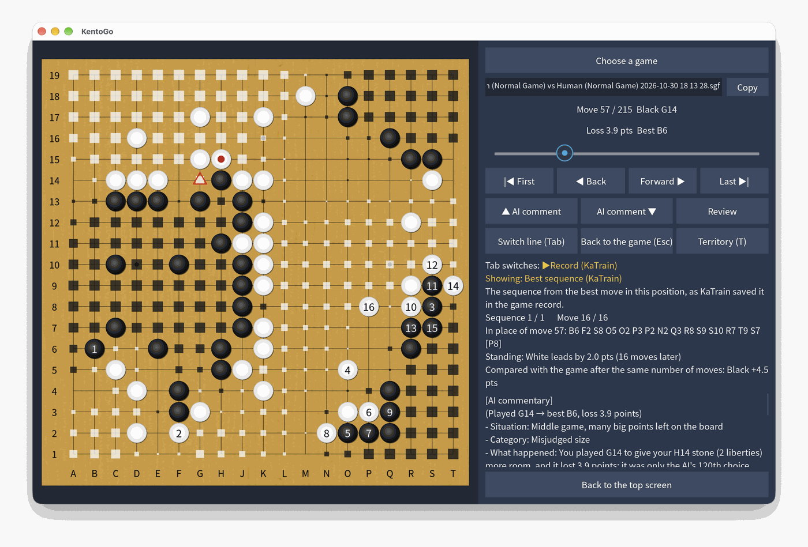

<p align="center">
  
</p>

<h1 align="center">KentoGo</h1>

<p align="center"><b>自分の失敗から学ぶ：KaTrain の対局から作る囲碁の問題。</b></p>

<p align="center"><a href="../README.md">English README</a></p>

<p align="center">
  <a href="https://github.com/thamer1024/KentoGo/releases/latest"></a>
  <a href="https://github.com/thamer1024/KentoGo/releases"></a>
  
  <a href="../LICENSE"></a>
</p>

KentoGo は、自分の対局で大きく目数を損した手を選び、もっと良い手が見つかるまで問題として繰り返し
出題します。棋譜の解析は KaTrain でも、KentoGo 自身が KataGo で行うこともできます。負けた生き死にや境界を
KataGo と打ち直す局地戦の問題、練習の成績表、対局の終局図を使った整地練習、KataGo の読み筋付きで棋譜を
見る機能、任意で使える AI による棋譜の解説もあります。無料の
オープンソースで、Windows と macOS で動きます。KataGo は KaTrain で設定したものを使います。

<p align="center"></p>

## できること

- **悪手問題**：大きく目数を損した手が問題になります。盤上に答えを打つと、KataGo が判定します
  （下の「答えの判定」）。問題は忘却曲線に沿って繰り返し出題されます。間違えた問題は翌日にもう一度
  出題され、正解するたびに3日、7日、14日…と間隔が延びます。決めた回数だけ続けて正解したら終わりです（初期値は少なめの2回で、
  もっと復習したいときは設定で増やせます）。間違えると回数は数え直しになります。損失の大きい問題から
  順に出す段階出題や、相手の大きなミスを咎められなかった場面の「咎め問題」もあります（下の「問題の選び方」）。
- **局地戦の問題**：KentoGo で解析した棋譜から、負けた生き死にや破られた境界を見つけ、その場所の決着が
  つくまで KataGo と打ち直します（下の「局地戦の問題」）。
- **成績表**：解いた問題、正答率、取り戻した目数、対局ごとの悪手の数を、練習した日ごとに確かめられます
  （下の「成績表」）。
- **KataGo による棋譜解析**：KentoGo 自身が棋譜を解析できます。1局約2分で、問題に要るものだけを
  SGF ファイルに書き込みます（下の「KentoGo で棋譜を解析する」）。
- **整地練習（設定でオンにします）**：自分の対局の終局図を数えます。死に石を取り除き、アゲハマを埋めて
  地を整え、自分の数えた目数を確かめます。地の整え方を KentoGo に見せてもらうこともできます（参考用で、
  目数は合っていても手順に誤りがあったり、人の整地とは違う不自然なやり方になったりすることがあります）。
- **棋譜を見る**：解析の最善手の読み筋（KentoGo のもの、または KaTrain のもの）と、それぞれの読み筋の
  終わりの地と形勢を見ながら、自分の対局を並べ直せます。
- **AI 解説（任意）**：ChatGPT、Claude、Gemini、DeepSeek などの AI に、自分の手と KaTrain が選んだ手の
  違いを、数値だけでなく文章で解説させることができます。それぞれの手のねらいや、どちらがなぜ良いかを
  説明します。KentoGo が作るプロンプトを好きな AI のチャットに貼り付けて答えを貼り戻すか、API キーを
  設定して KentoGo から直接 AI に尋ねさせることもできます。

| 悪手問題 | 整地練習 | 棋譜を見る |
| --- | --- | --- |
|  |  |  |

## ダウンロード

- **Windows**：[最新のリリース](https://github.com/thamer1024/KentoGo/releases/latest)から
  `KentoGo-x.y.z-windows.exe` を入手します。1つのファイルなので、そのまま起動してください。
  （`KentoGo-x.y.z-windows.zip` は同じプログラムのフォルダ版で、起動が速くなります。）
- **macOS**：同じページから `KentoGo-x.y.z-macos.zip` を入手し、展開して KentoGo.app を開きます。
- **Linux**：ソースから起動してください（下の「ソースから起動する」）。

KataGo は含まれていません。KentoGo は [KaTrain](https://github.com/sanderland/katrain) で設定した
KataGo を使います。

KentoGo.exe には署名がありません。初めて起動したとき、Windows が「Windows によって PC が保護されました」
と表示して止めることがあります（ダウンロードした人の少ないプログラムに Microsoft Defender SmartScreen
が出すものです）。「詳細情報」を押してから「実行」を押してください。同じファイルで再び聞かれることは
ありません。

アプリには Apple の署名もありません。GitHub からダウンロードしたアプリは、初回は macOS に止められます。
右クリックから「開く」で開くか、`xattr -dr com.apple.quarantine KentoGo.app` を実行してください。

## はじめ方

1. KaTrain と KataGo を設定します。自分の対局をいくつか KaTrain で解析しておくか、KentoGo に解析させます
   （下の「KentoGo で棋譜を解析する」）。級位者が KentoGo で使うだけなら、KaTrain での解析よりも KentoGo で
   解析してください。出題する問題だけに絞って深く解析するので、SGF ファイルのサイズが抑えられます。より深く
   検討する段位者は KaTrain で解析してください。
2. KentoGo を起動します。最初の起動で、KaTrain のエンジン設定を `~/.katrain/config.json` から
   写します。その設定が KaTrain のプログラムの中を指している場合（Windows の KaTrain の初期設定のように
   `katrain/` で始まるパス）は、よくある場所から KaTrain のプログラムのフォルダを探します。見つからない
   ときは、設定画面で「KaTrain のプログラムのフォルダ」を指定するか、KataGo・モデル・KataGo の設定
   ファイルのパスを直接指定してください。
3. 設定画面で SGF ファイルのフォルダを選びます。プログラム版は、別のフォルダを選ぶまでは
   `~/.kentogo/games` を使います。ソースから起動した KentoGo は、その `games` フォルダを使います
   （SGF ファイルが git に入ることはありません）。

各画面の使い方、設定を変えると何が変わるか、遅いときにどうするかは、[ユーザーガイド](USER_GUIDE.md)にあります。

### KaTrain での棋譜の準備

KaTrain で解析した棋譜では、KentoGo は KaTrain が SGF ファイルに保存した内容から問題を作ります。
KaTrain で次のようにしておくと、より良い問題になります。

1. KaTrain の「指導・分析設定」で、自分のレベルに合わせて「SGFに保存」にチェックを入れ、
   「分析結果をSGFに保存」にもチェックを入れます。
2. 終局後に、自分のマシンで快適な範囲の「着手毎の探索手数」を指定して「一局全体を深く分析」で解析させて
   から（「分析を悪手だけに限定」でも構いません）、SGF を保存します。KaTrain の読み筋がより正確に残ります。

### KentoGo で棋譜を解析する

トップ画面の「KataGoで棋譜解析」を押すと、棋譜フォルダの棋譜が一覧に出ます。まだ解析していない棋譜
（と読めないファイル）には最初からチェックが付いています。KentoGo で解析済みの棋譜は、表示するように
選んだときだけ一覧に出ます。チェックした棋譜はすべて解析します（KaTrain で解析済みの棋譜も）。途中で
止めることもでき、そのとき解析している棋譜が終わったところで止まります。

1局は次の3段階で解析し、推奨設定では1局約2分です。

1. すべての局面を浅く読みます（「高速解析の探索数」、50未満にはしません）。
2. 打った手を読んで、目数を損した手を見つけます。
3. 問題になりうる手（浅い読みの損失が、問題の基準の半分以上の手）を深く読みます（「深く検討する手の
   探索数」。1局で「深く検討する手の数」まで、損失の大きい順）。この深い読みで十分に損した手だけが
   問題になります。

書き込む前に、各ファイルを棋譜フォルダの `backup` フォルダに写します（名前に時刻が付きます）。KentoGo は
問題に要るものだけを、自分の解析データ（`KGA`）として SGF ファイルに書き込みます。KaTrain の解析データ
（`KT`）、自分のメモ、AI 解説はそのまま残ります。探索数は ☰ の「KataGo棋譜解析（SGFに書き込む）」で
設定します。

### KentoGo での KataGo

KataGo にかかる時間はコンピューターによって大きく違います。読みの数（visits）は設定画面で変えられるほか、
☰ の「推奨設定」で自分のコンピューターの種類（GPU のない古いプロセッサーから高性能な GPU まで）を
選べます。その画面の一番下の「測る」を押すと、使っているモデルで KataGo の速さを測り、そこから探索数を
決めます。モデルを替えたら、もう一度押してください。

tf3 で始まる名前のモデル（一番新しい種類）が速く動くのは、NVIDIA の RTX で CUDA 版か TensorRT 版の
KataGo を使ったときだけです。それ以外（KaTrain に同梱の KataGo、GTX・Radeon・内蔵 GPU、GPU のない
パソコン、Mac）では、b28c512nbt か b18c384nbt のモデルをお勧めします。M5（無印）の Mac では、1秒に
tf3 のモデルが約170、b28 が約420、b18 が約960 の探索を読みました。

KataGo は KaTrain と同じく KentoGo と一緒に起動し、KentoGo を閉じるまで動き続けます。読み込み中は、
どのモデルを読み込んでいるかと、2回目の起動からはあとどのくらいかかるかをダイアログで表示します
（読み込みにかかった時間は `~/.kentogo/katago_start_times.json` に記録します）。ダイアログを閉じて先に
進むこともでき、その場合 KataGo への問い合わせは準備ができるまで待ちます。

### 問題の選び方

☰ の「出題・判定設定」で、次のように出題を絞れます。

- **段階出題**：「段階出題の目数」に `20,10,5,3` のように書くと、20目以上損した問題から出し、その段階の
  問題をすべて一度正解すると、10目以上の問題へ進みます（空欄なら使いません）。
- **咎め問題**：直前の相手の手が大きく損した（初期値15目以上）のに、自分の手も損した（初期値5目以上）
  場面です。「出題する問題」で「咎め問題だけ」を選ぶと、これだけを出します。
- 置き碁では、置き石による最初のリードを差し引いて、もう勝負が決まった局面かどうかを判断します。

### 答えの判定

答えの損失を、実戦で打った手の損失と比べます。値は ☰ の「出題・判定設定」で変えられます。

- 小さい問題（実戦の手の損失が「小さい問題の境目」未満、初期値3目）では、実戦の手より損が大きくなければ
  正解です。
- それ以外の問題では、損失のうち「合格ライン」（初期値0.6：損失の60%）以上を取り戻し、さらに「正解とする
  答えの損の上限」を決めているときは、答えの損がその上限以下なら正解です（初期値は0：上限なし）。初期値の
  ままなら、20目損した問題で8目損の答えは正解です。
- 「許容幅」（初期値1目）以下の損の答えは、いつでも正解です。

損失は画面に出るとおり0.1目に丸めて、取り戻した割合も画面に出るとおり整数の % で判定します。

強くなるにつれて、KentoGo が判定を厳しく（または易しく）することを提案します。使うのは、普通の問題の
直近の答え（「提案に使う直近の問題数」、初期値30）です。

- 合格ラインは、取り戻した割合の平均が次のラインより5%以上高いと0.1上げ（0.9まで）、今のラインより
  10%以上低いと0.1下げます（0.5まで）。
- 答えの損の上限は、正解が3分の1以上で、正解の平均の損が次の上限より小さく、正解の8割以上が次の上限以内に
  収まるときに、一段ずつ提案します（上限なし → 12 → 8 → 5 → 3目：「提案する答えの損の上限の段階」）。

提案は一度に1つだけです（合格ラインが先）。提案に答えたあとは、同じ数だけ解いてから次を考えます。
保存済みの答えを判定し直すことはありません。

### 回答後の手順

答えたあと、Tab で次の手順に、Shift+Tab で前の手順に切り替えます（上の行に順番が出ます）。

1. **段級位の応手**：あなたの答えのあと、あなたは自分の級位相当の手、相手は相手の段級位相当の手
   （分からないときはあなたと同じ段級位）で進めた手順。
2. **実戦**：実戦で打った手と、その後に対局で実際に打たれた手（棋譜のとおり）。
3. **この局面の最善手**：問題の局面から、あなたは自分の級位の人が打ちそうな手の中の最善手、相手は相手の
   段級位相当の手（分からないときはあなたと同じ段級位）で進めた手順。

1 と 3 の手順の作り方：

- 1 のあなたの手は、KataGo の人間風モデルの、あなたの級位の人が一番打ちそうな手です。級位は棋譜の
  `BR`/`WR`、なければ AI 解説で入力した段級位を使います。相手の級位しか分からないときは、それを使います。
- 相手の手は、同じように、相手の段級位の人が一番打ちそうな手です。
- 3 のあなたの手は、人間風モデルが出す、あなたの級位の人が打ちそうな手の中の最善手です。手順の中の
  あなたの手すべてに使います。
  - 候補は、一番打ちそうな手の5%以上の確率がある手です（最大12手）。
  - 候補だけを標準の KataGo に読ませて、損が一番小さい手を選びます。損の差が0.3目以内の手は同じ強さとみなし、
    その中で一番打ちそうな手にします。
  - 最初の1手は、設定画面の最大探索手数（「読みの深さ」）で読みます。2手目以降は、「地と形勢の探索手数」
    （初期値100）の2倍です。
  - 選んだ手ごとの記録（候補、確率、損、読んだ時間、制限なしで読んだ最善手との差）は、
    `~/.kentogo/human_line.jsonl` に追記され、コンソール（標準エラー）にも出ます。
- どちらの級位も分からないときは、両方とも標準の KataGo の最善手で進めます（1 は KataGo の読み筋のままです）。
- 3つの手順は、実戦の手数（実戦の手順が10手より短いときは10手、20手より長いときは20手）に合わせて、
  同じ手数まで延ばします。実戦の手順がそれより短い場合は、実戦の手順が短いままです。
- 時間で打ち切ることはしません。パソコンの性能は人によって違うからです。代わりに、1回の読みは、設定画面の
  「分析の最大時間（秒）」で止まります（0なら制限なし）。遅いパソコンでは、1回の読みで読む手数が減ります。
- 盤上の「□最善」と、結果の「最善 〇〇：…」の手は、この局面の最善手（3 の最初の手）です。計算中は
  「KataGoが考えています…」と出て、手は出ません。KataGo が使えないときや失敗したときは、最善手は出ません
  （棋譜の解析が残した KataGo の最善手は出しません）。最善手が決まったあと、その手の働きを調べている間は
  「最善手の働きを調べています…」と出ます。
- 3 は、回答の判定が終わってから作ります。棋譜に残った最善手の手順（KentoGo／KaTrain）は使いません。

手順を一手ずつ進めると、盤にその手の時点の地の色が出て、手順の説明の下にその局面の形勢の目安
（浅い読み）が出ます。手順の最後の手では、正確な形勢が出ます。「段級位の応手」と「この局面の最善手」では、
実戦の同じ手数との比較（実戦に対して取り戻した目数）も出ます。

### 回答を保存せずに問題を試す

KentoGo で解析した棋譜の問題を、1日の上限なしで、回答を保存せずに試すには、ソースから `--test-quiz`
を付けて起動します。

```
uv run kentogo --test-quiz loss     # 自分の失敗した手（損失目数による問題）
uv run kentogo --test-quiz punish   # 相手の大きなミスを咎められなかった問題
```

その種類の問題を、1局の出題数を超えた分も含めてすべて出します。使うのは KentoGo で解析した棋譜
（トップメニューの「KataGoで棋譜解析」）だけです。問題が1つもないときは、読んだフォルダと、読んだ棋譜の数、
そのうち KentoGo で解析した棋譜の数を出します。

設定、回答の履歴、整地練習の結果は `~/.kentogo`（Windows では `C:\Users\<名前>\.kentogo`）に保存します。
プログラム版にはコンソールがないため、メッセージは `~/.kentogo/kentogo.log` に書き出します。
復習設定の「学習履歴を消す」ボタンは、回答の履歴を `~/.kentogo/backups/history-<日付>-<時刻>.sqlite3` に
写してから消します（元に戻すには、これを `~/.kentogo/history.sqlite3` と置き換えます）。局地戦の問題の回答
（`fight_history.sqlite3`）を消すボタンと、整地練習を使う設定のときは整地練習の結果（`seichi_history.sqlite3`）を
消すボタンもあり、同じようにバックアップを作ります。AI 解説の履歴は残ります。
KataGoで棋譜解析に1局ずつどれだけ時間がかかったか（手順ごと）は、1局を1行の JSON にして
`~/.kentogo/analysis_timing.jsonl` に追記し、コンソールにも `KENTOGO_ANALYSIS_TIMING ` に続けて出します。

## 局地戦の問題

KentoGo の解析で見つかった、自分が負けた局地戦の問題です。KataGo の地の判断から、次の2種類を見つけます。

- **生き死にの練習**：自分の石が取られた、または相手の石を生かしてしまった場面。
- **境界の練習**：自分の地だった場所を破られた場面。

トップ画面の「局地戦の問題（生き死に・境界）」から始めます（KataGo が必要です）。戦いが始まった局面から、
その場所の決着がつくまで KataGo と交互に打ちます。

- 戦いに勝ち、最初の局面からの目数の減りが許容範囲（初期値3目）なら正解です。
- 戦いに負けたとき、目数が減りすぎたとき、戦いから手を抜いたときは不正解です。打たなくてもよい手を打って
  損したときも不正解です。
- 終わったあと、Tab（またはボタン）で、両者が人間風の手で打つ「AI同士」の手順を見られます。← → で一手ずつ
  動かせます。結論が出なかったときは、KataGo の最善手でも打ち直して比べられます。追いかけている石があると
  きは、取れるか逃げ切るまで手順を続けます。

局地戦の問題は悪手問題と別に復習され、1日の最大問題数の初期値は5問です。ここに含まれる悪手は、悪手問題には
出ません。相手の打ち方（KataGo の最強の応手、または相手の段級位の人間風の応手）と許容する目数は
「局地戦の問題（生き死に・境界）の設定」で、復習の方法は「局地戦の問題（生き死に・境界）の復習設定」で
変えられます。回答は `fight_history.sqlite3` に保存します。

## 成績表

トップ画面の「成績表」で、練習の結果を確かめられます。練習しなかった日で数字が下がらないように、週ではなく
練習した日で数えます。

- **悪手問題**：これまでに解いた問題、正解、完了した問題、取り戻した目数、練習した日数と、最近5回の練習の
  正答率・平均の取り戻し率（その前の5回との比較）。練習した日ごとのグラフも出ます（最大14回）。
- **局地戦の問題**：同じように、解いた問題、正解、完了した問題、練習した日数、最近5回の正答率とグラフ。
- **対局ごとの悪手の数**：損失の大きさで分けて数えたグラフと、直近5局の平均（その前の5局との比較）。

悪手問題や局地戦の問題からトップ画面に戻ると、その日に解いていれば「今日のまとめ」が出ます。解いた問題と
正解のほか、問題全体の件数、完了、実施中、手付かずの件数を確かめられます。悪手問題では、取り戻した目数、
練習した日数、達成したこと（段階のクリア、正解100問ごと、取り戻した目数1,000目ごと）も出ます。

## 棋譜を見る

トップ画面の「棋譜を見る」で、棋譜を一手ずつ見られます。各手の損失、解析の最善手、AI 解説、自分のメモが
出ます。← → キー（または Space と Shift+Space）で一手ずつ、↑ ↓ で前・次の AI 解説へ、Home / End で
最初・最後の手へ進みます。

ある手で Tab を押すと、その手の代わりに解析の最善手の読み筋（KentoGo のもの、または KaTrain のもの）、
次に SGF ファイルのほかの分岐、そのあと本譜に戻ります。Shift+Tab で逆の順に、Esc で本譜に戻ります。
T を押すと、表示しているすべての局面の地と形勢の目安が出ます（もう一度押すと消えます）。読み筋の最後の
手では、正確な形勢と、本譜の同じ手数との比較が出ます。

## 整地練習

整地練習は最初はオフです。設定画面の「整地練習も使う（トップ画面にボタンを出す）」をオンにしてください。
対局の終局図を、日本ルールで整地します。整地が終わったら「整地終了」を押して答え合わせをし、「できた」か
「できなかった」を押すと、次の棋譜に進みます（この2つのボタンは、「整地終了」か「コンピュータの整地を
見る」の後に出ます）。画面には、そのとき使えるボタンだけが出ます。できなかった棋譜は、悪手問題と同じ
ように後日また出題されます。出題順・先に出す棋譜・復習の方法・1日の最大局数は、トップ画面の ☰ メニュー
の「整地練習設定」で変えられます（結果は設定ファイルと同じフォルダの `seichi_history.sqlite3` に保存
されます）。

1. 死に石をクリックしてください（つながった石がまとめて死に石になります。もう一度で元に戻ります）。
2. 死に石を取り上げます。盤の外にドラッグするか、「死に石を取り除く」を押します。
3. ダメ（どちらの地でもない空き点）をクリックして石で詰めます。詰めた石をもう一度クリックすると戻ります。
4. 「終局を確認して整地に入る」を押します。このときの地の目数が、整地で守る目数になります。

地と数えている点には、小さな四角が付きます。

整地に入ると、石は自由に動かせます（境界の石も）。目数は終局確認時の地を覚えているので、境界の石が
動いても変わりません。どちらの地かわからなくなった空き点は、クリックすると 黒地→白地→どちらでもない
の順に決められます。決まっていない空き点の数は右側に出ます。「コンピュータの整地を見る」は、終局確認時の
盤面から整地します（整地に入った後に動かした石は使いません）。

- 石をドラッグして空いている点に置くと動きます。
- 相手の色の石の上に置くと、2つの石が入れ替わります。
- アゲハマは下の置き場から盤にドラッグして、同じ色の地に埋めます。バラの石はまとめて、x10 は10個
  まとめて、置いた場所の空きに端から埋まります。盤の外に出すと置き場に戻ります。
- セキの目や、セキで共有しているダメは地に数えません（goscorer で判定します）。

「コンピュータの整地を見る」を押すと、整地の手順をすぐに一手ずつ再生します。そのあとも、再生ボタンや
←→ キーで手順をたどれます。最後に相手の地の中に石が残るような整地はしません。どうしても残る局面
（死に石を取り忘れたときなど）では、そう知らせて整地しません。動いた石の元の場所に △、石を置いた場所に
○ が付きます。自分の石だけでは十目単位にできないときは、「石の交換」（盤上の黒石と白石を入れ替える）を
します。碁笥を使って石の色を替えることはしません。それが必要な形にしかならないときは、きれいな形を
あきらめて、自分の地の中で石を動かして十目単位に近づけます。

コンピュータの整地はプログラムが作るものなので、参考として見てください。結果の目数は合っていても手順に
誤りがあったり、人が整地するときとは違う、不自然なやり方になったりすることがあります。

## 言語

最初の起動は英語です。悪手問題の開始画面か、トップ画面の ☰ ボタンのメニューにある国旗（KaTrain と同じ）を
押すと、すぐにその言語に切り替わり、次回の起動でもその言語で表示されます。言語は
`~/.kentogo/settings.json`（`"general": {"language": "jp"}`）に保存します。対応言語：英語、ドイツ語、
フランス語、ウクライナ語、スペイン語、ロシア語、中国語（簡体字・繁体字）、韓国語、日本語、トルコ語。

AI 解説も言語に合わせます。日本語では日本語のプロンプトを、それ以外の言語では英語のプロンプトを使い、
画面の言語で答えるように AI に頼みます。答えと一緒に KentoGo が棋譜に書き込む言葉も、その言語になります。
プロンプトはそれぞれ変更用のファイルがあります（☰ の AI 解説の設定）。設定ファイルと同じフォルダの
`commentary_prompt_jp.txt`（日本語）と `commentary_prompt_en.txt`（英語のプロンプト）です。

## 更新履歴

各バージョンでは、追加した機能と変わった機能、つまり KentoGo を使うときに気づく変更を中心に書きます。
コードの中だけの変更は、最後に短くまとめます。

### 0.3.0

追加した機能：

- **局地戦の問題**（生き死に・境界）を追加しました。KentoGo が解析した棋譜から、負けた局地戦を見つけ、
  戦いが始まった局面から、その場所の決着がつくまで KataGo と打ち直します。トップ画面の
  「局地戦の問題（生き死に・境界）」から始めます（「局地戦の問題」を参照）。
  - 専用の復習と履歴（最初は1日に5問まで）、専用の設定（相手と許容する目数）、
    バックアップを作ってから履歴を消すボタンがあります。
  - 戦いのあと、Tab（または「AI同士の進行を見る」ボタン）で、両者が人間風の手を打つ手順を出し、← → キーで
    進めます。それで決着がつかないときは KataGo の最善手でも打ち直し、Tab で二つを切り替えます。
    追いかけている石は、取られるか逃げ切るまで続けます。
- 成績表に局地戦の問題の結果を追加しました。
- 今日のまとめに、問題全体の件数、完了、実施中、手付かずの件数を出すようにしました。
- ユーザーガイドを、英語（`USER_GUIDE.md`）と日本語（`japanese/USER_GUIDE.md`）で追加しました。遊び方、
  設定を変えると何が変わるか、遅いときに何を変えればよいかを書いています。
- WSL の KentoGo から Windows の `katago.exe` を使えるようにしました（渡すパスを Windows の形に変えます）。

変わった機能：

- 局地戦の中の自分の悪手は、悪手の問題としては出さず、局地戦の問題として出すようにしました。
- KataGo の最善の応手が盤の別の場所になったら、局地戦を終わりにするようにしました。
- 判定する場所がない局地戦は出さないようにしました。
- 局地戦のあとの AI 同士の手順で、段級位が分からないときは両者とも 9段 で打つようにしました。

修正：

- 悪手の問題と局地戦の問題で、石を打った直後に盤を描き直すようにしました。

コードの中の変更（使い方は変わりません）：画面とロジック、機能どうしの分離を進めました（履歴の読み書き、
AI 解説の手順、棋譜の読み込み、画面の文言の整理）。Windows で KataGo を起動するコマンドを、KaTrain と同じものに
戻しました。

### 0.2.0

- KentoGo 自身による KataGo の棋譜解析を追加しました。トップ画面から棋譜を選び、問題になりうる手だけを深く読んで、
  必要なものだけを SGF ファイルに書き込みます。
- 成績表と今日のまとめを追加しました。
- 段階出題、咎め問題、置き碁への対応を追加しました。
- 答えの損の上限と、合格ライン・損の上限の変更の提案を追加しました。判定は画面に出る数字（0.1目、整数の %）で
  行います。
- 回答後の手順を、段級位の応手、実戦、この局面の最善手に整理しました。人間風の手を使い、手順の長さをそろえ、
  Shift+Tab で前の手順に戻れます。
- 回答後と棋譜を見る画面で、一手ごとの地と形勢の目安、手順の最後の正確な形勢を出すようにしました。
- 最善手の働き（アタリ、シチョウなど）を出すようにしました。
- KataGo が止まったときの再起動、読み込み中の表示、`--test-quiz` を追加しました。
- 学習履歴と整地練習の結果を、日付付きのバックアップを作ってから消せるようにしました。

## ソースから起動する

1. [uv](https://docs.astral.sh/uv/) をインストールします（KentoGo のための Python 3.12 も入れます）。
2. KentoGo を入手します。このリポジトリを `git clone` するか、zip ファイルとしてダウンロードして展開します。
3. KentoGo のフォルダで、次を実行します。

   ```
   uv run kentogo
   ```

   最初の起動ではライブラリをインストールするので、時間がかかります。

## 開発（macOS または WSL）

```
uv sync                  # 環境を作る（Python 3.12 とライブラリ）
uv run pytest            # テストを実行する（KataGo は不要）
uv run ruff check        # コードを検査する
uv run ruff format       # コードを整形する
```

- すべてのシステムで同じコードです。システムによって違うのは
  `src/kentogo/katago/locate.py`（KaTrain と KataGo の場所）と
  `src/kentogo/katago/process.py`（KataGo の起動の仕方）だけです。
- WSL では、プロジェクトを `/mnt/c` の下ではなく Linux のファイルシステム（例：`~/KentoGo`）に置いて
  ください。`/mnt/c` は遅いためです。Windows 11 では WSLg でウィンドウが表示されます。KataGo は Linux 用の
  ものに加えて、Windows の `katago.exe` も使えます（KataGo に渡すパスは Windows の形式に直します）。
- GitHub Actions が、push のたびに Windows・macOS・Linux で検査とテストを実行します
  （`.github/workflows/test.yaml`）。

## プログラムを作る（KentoGo.exe と KentoGo.app）

プログラムはそれぞれのシステムで作ります（PyInstaller は macOS で Windows のプログラムを作ることも、
その逆もできません）。

- Windows：KentoGo のフォルダで、PowerShell で次を実行します。

  ```
  powershell -ExecutionPolicy Bypass -File packaging\windows\build.ps1
  ```

  同じファイルから、2つの形の KentoGo.exe を作ります。
  - `dist\KentoGo.exe`：すべてを1つにまとめたファイル。起動のたびに一時フォルダに展開するので、
    起動が少し遅くなります。
  - `dist\KentoGo`（中の `KentoGo.exe` を起動）、`dist\KentoGo-windows.zip` にもまとめます：
    フォルダ版で、起動が速くなります。

  CUDA や TensorRT は要りません。最近の NVIDIA のディスプレイドライバーは CUDA のフォルダを PATH に
  入れますが、このスクリプトはプログラムを作る間だけそれを PATH から外し、その DLL を取り込みません。
- macOS：KentoGo のフォルダで、次を実行します。

  ```
  bash packaging/macos/build.sh
  ```

  `dist/KentoGo.app`（開くか、アプリケーションフォルダに移します）と `dist/KentoGo-macos.zip` を作ります。
  アプリはその Mac のプロセッサー（Apple シリコンか Intel）用に作られます。自分の Mac で作ったアプリは
  そのまま開けます。
- GitHub では、「windows-exe」か「macos-app」の workflow を実行します（Actions > その workflow > Run
  workflow）。プログラムは実行結果のページからダウンロードできます。`v0.1.0` のようなタグでも実行されます。
- プログラムを公開するには、「release」の workflow を実行します（Actions > release > Run workflow）。
  選んだブランチの最後のコミットから両方のプログラムを作り、新しいリリース（Releases）に
  `KentoGo-0.1.0-windows.exe`（1ファイル）、`KentoGo-0.1.0-windows.zip`（フォルダ版）、
  `KentoGo-0.1.0-macos.zip` として置きます。バージョンは、コミットに書かれた時刻の時・分・秒です
  （00:01:00 に作ったコミットは 0.1.0、タグは `v0.1.0`）。プログラムはバージョンをトップ画面の下に表示し、
  KentoGo.exe はファイルのプロパティ（詳細）にも表示します。ソースから起動した KentoGo には表示されません。

アイコン（階段状の石の壁で黒地と白地に分かれた盤）は `packaging/icons` にあり、ウィンドウの同じアイコンは
`src/kentogo/images/app_icon.png` です。
`python tools/make_icon.py packaging/icons --window-icon src/kentogo/images/app_icon.png`
で作ります（Pillow が必要です）。

## 謝辞

KentoGo は2つのプロジェクトの上に作られています。その作者に感謝します。

- David J. Wu（lightvector）さんの [KataGo](https://github.com/lightvector/KataGo)：対局を解析し、
  答えを判定する囲碁エンジン。
- Sander Land（sanderland）さんの [KaTrain](https://github.com/sanderland/katrain)：対局を打ち、解析する
  アプリ。KentoGo はその解析を読み、見た目もそれに合わせています。

KentoGo は独立したプロジェクトです。KaTrain や KataGo の一部ではなく、その作者が推薦しているものでも
ありません。MIT ライセンスで公開しています（`LICENSE` を参照）。ほかのプロジェクトから来た部分は
`THIRD_PARTY_NOTICES.md` に載せています。

## KentoGo の作り方

作者が KentoGo を設計し（機能と構成）、その設計に沿って、作者との対話を通じて Claude Code
（Anthropic の AI コーディングツール）がコードを書きました。
